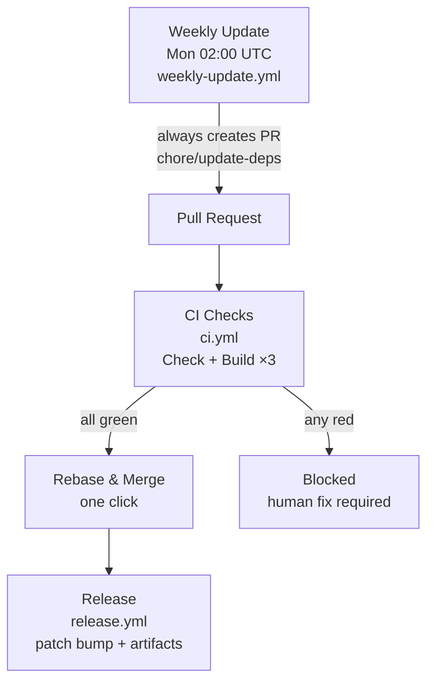

# actions


Reusable GitHub Actions flow: **Weekly Update → PR with full-matrix CI gate → Rebase & merge → Auto Release**. Designed for AI agents to apply to new Go + Bun + Wails projects.

## Flow



* **Weekly Update** always opens/updates a PR (`chore/update-deps`, label `dependencies`) after `Delnegend/actions/go-min-age@v1` (Go `proxy.golang.org` 14d filter, `go get -d` per-module) + `bun update --minimum-release-age` (14d). No local build validation — `ci.yml` is the single gate (saves minutes, avoids duplication).
* **Repo-level min-age**: `frontend/bunfig.toml:1` `[install] minimumReleaseAge = 1209600` (14d) enforces on every `bun install`/`add` locally and in CI; Go has no official repo-level, so only action-level via composite.
* **CI** runs full matrix (`linux/amd64`, `darwin/universal`, `windows/amd64`) + `just check` on every PR to `main`. Weekly is cheap, so full matrix is acceptable.
* **Branch protection** on `main` requires 4 checks + linear history. Only `Rebase and merge` is allowed.
* **Release** runs only on `pull_request:closed` to `main` with `dependencies` label or `chore/update-deps` head — auto patch bump (`v0.0.0` → `v0.1.0` → `v0.1.1` …) and `softprops/action-gh-release`.

## Quick Start (for humans)

```bash
# 1. Copy templates to your repo
cp -r templates/.github ./
cp scripts/setup-branch-protection.sh ./scripts/

# 2. Customize
# - Edit BINARY_NAME in release.yml & ci.yml
# - Edit BUN_MIN_RELEASE_AGE / GO_MIN_RELEASE_AGE if needed
# - Edit justfile `check` recipe to match your stack

# 3. Apply branch protection (requires gh cli)
./scripts/setup-branch-protection.sh Delnegend/your-repo

# 4. Push to main
git add .github/workflows/ci.yml .github/workflows/weekly-update.yml .github/workflows/release.yml
git commit -m "ci: add weekly→PR→CI→release flow from actions template"
git push
```

## Templates

| File | Purpose | Trigger |
|------|---------|---------|
| `templates/ci.yml` | Full-matrix checks + `just check` | `pull_request` to `main`, `push` to `main` |
| `templates/weekly-update.yml` | Weekly dep bump via `go-min-age` composite + `bun` 2-week min-age + TS6 hold | `schedule` Mon 02:00 UTC, `workflow_dispatch` |
| `templates/release.yml` | Cross-platform build + auto patch release | `pull_request:closed` to `main`, `workflow_dispatch` |
| `templates/package.json.overrides` | Bun `overrides` + comment for TS hold | Bun |
| `templates/frontend/bunfig.toml` | Repo-level `minimumReleaseAge = 1209600` (14d) | `bun install`/`update` |
| `go-min-age/action.yml` | Composite for Go `proxy.golang.org` 14d filter (`go get -d` per-module) | `uses: Delnegend/actions/go-min-age@v1` |
| `draft-pr-body/action.yml` | Composite for PR body from `go.mod` + `frontend/package.json` diffs | `uses: Delnegend/actions/draft-pr-body@v1` |

See `docs/FLOW.md` for detailed behavior and `AGENTS.md` for AI agent instructions.

## AI Agent Guide

This repo is optimized for AI agents. See [AGENTS.md](./AGENTS.md) for step-by-step instructions to apply the flow to a new project. The agent should:

1. Detect stack (`go.mod`, `frontend/package.json`, `justfile`)
2. Copy and customize templates (replace `BINARY_NAME`, adjust `libgtk` deps, etc.)
3. Run `scripts/setup-branch-protection.sh` via `gh api`
4. Verify with `python3 -c "import yaml; yaml.safe_load(...)"`

## License

MIT
