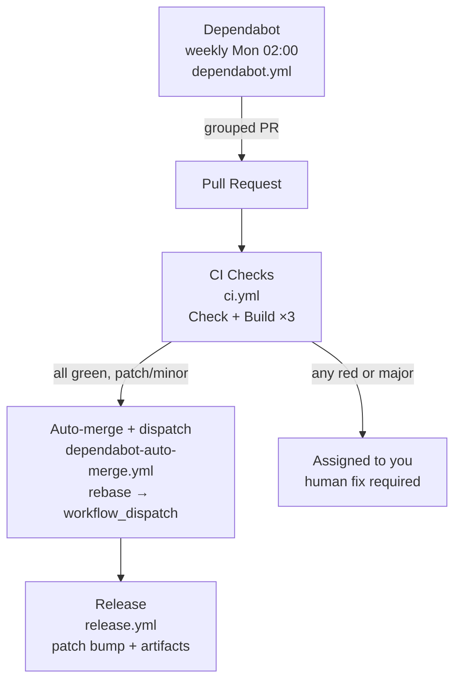

# actions


Reusable GitHub Actions flow: **Weekly Update → PR with full-matrix CI gate → Rebase & merge → Auto Release**. Designed for AI agents to apply to any workspace — `Go + Bun + Wails` is just an example, adapt `just check` and build steps to your stack.

## Flow



* **Dependabot** creates/updates PRs (`gomod` + `npm` frontend, 1 per ecosystem, grouped `all-dependencies`, `cooldown: 14d`) weekly Mon 02:00, label `dependencies`, `assignees: [Delnegend]` (always), `ignore: typescript >=7.0.0` for TS6 hold. No local build validation — `ci.yml` full-matrix is the single gate (pure YAGNI).
* **Dependabot auto-merge** (`dependabot-auto-merge.yml:1` `on: pull_request` + `workflow_dispatch`) gates `major` (`fetch-metadata@v2:1` `update-type != major`) and enables `gh pr merge --auto --rebase:1` for patch/minor when `actor == dependabot[bot]` + `label dependencies`; then `dispatch-release` polls until `MERGED` and `gh workflow run release.yml --ref main` (via `workflow_dispatch` — `GITHUB_TOKEN` `pull_request: closed`/`push` are suppressed after auto-merge, so `workflow_dispatch` is required). On red, PR stays open assigned to you (`weekly: update dependencies PR -> ci guards -> ok ? merge+dispatch+release new version : assign me to the PR`).
* **CI** runs full matrix (`linux/amd64`, `darwin/universal`, `windows/amd64`) + `just check` on every PR to `main` (example for `Wails`; adapt `just check` + build matrix to your language/stack). Weekly is cheap, so full matrix is acceptable.
* **Branch protection** on `main` requires 4 checks + linear history. Only `Rebase and merge` is allowed, `allow_auto_merge: true:1` for Dependabot patch/minor.
* **Release** runs on `workflow_dispatch` (dispatched by `dispatch-release` with auto patch bump, `release_version` optional) or `pull_request:closed` to `main` with `dependencies` label (fallback for manual merges) — auto patch bump (`v0.0.0` → `v0.1.0` → `v0.1.1` …) and `softprops/action-gh-release`.

## Quick Start (for humans)

```bash
# 1. Copy templates to your repo
cp templates/ci.yml .github/workflows/ci.yml
cp templates/release.yml .github/workflows/release.yml
cp templates/dependabot.yml .github/dependabot.yml
cp templates/dependabot-auto-merge.yml .github/workflows/dependabot-auto-merge.yml
cp scripts/setup-branch-protection.sh ./scripts/

# 2. Customize (all placeholders are examples — keep only what your stack needs)
# - Edit BINARY_NAME in release.yml & ci.yml
# - Edit cooldown in dependabot.yml (14d) if needed
# - Edit justfile `check` recipe to match your stack (`go vet`, `oxlint`, etc.)
# - For non-Wails, remove `libgtk`/`wails` steps in ci.yml/release.yml (see AGENTS.md#customization)

# 3. Apply branch protection (requires gh cli)
./scripts/setup-branch-protection.sh Delnegend/your-repo

# 4. Push to main
git add .github/workflows/ci.yml .github/workflows/release.yml .github/workflows/dependabot-auto-merge.yml .github/dependabot.yml frontend/package.json
git commit -m "ci: add dependabot→PR→CI→release flow from actions template"
git push
```

## Templates

| File | Purpose | Trigger |
|------|---------|---------|
| `templates/ci.yml` | Full-matrix checks + `just check` | `pull_request` to `main`, `push` to `main` |
| `templates/dependabot.yml` | Weekly grouped deps, 14d cooldown + TS6 ignore (`schedule` weekly Mon 02:00) | `dependabot` app |
| `templates/dependabot-auto-merge.yml` | Auto-merge patch/minor + dispatch Release (`fetch-metadata` gate, `gh pr merge --auto --rebase` → `gh workflow run release.yml`) | `pull_request` + `workflow_dispatch` |
| `templates/release.yml` | Cross-platform build + auto patch release | `pull_request:closed` (fallback) + `workflow_dispatch` (primary via dispatch) |
| `templates/package.json.overrides` | Bun `overrides` + comment for TS hold | Bun |

See `AGENTS.md#detailed-flow` for detailed behavior.

## AI Agent Guide

This repo is optimized for AI agents. See [AGENTS.md](./AGENTS.md) for step-by-step instructions to apply the flow to a new project. The agent should:

1. Detect stack (`go.mod`, `frontend/package.json`, `justfile`, `wails.json` — examples; adapt to any workspace)
2. Copy and customize templates (replace `BINARY_NAME`, keep only build steps your stack needs — Wails `libgtk`/`wails build` is just an example)
3. Run `scripts/setup-branch-protection.sh` via `gh api`
4. Verify with `python3 -c "import yaml; yaml.safe_load(...)"`

## License

MIT
