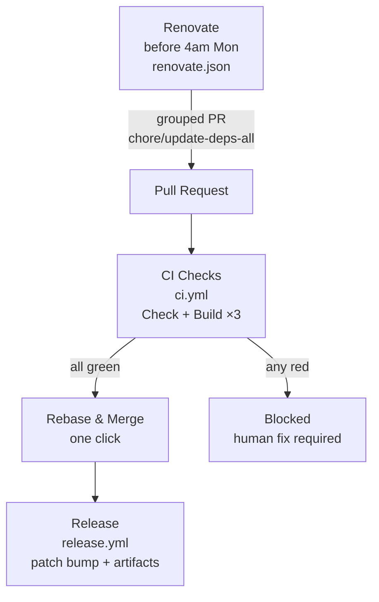

# actions


Reusable GitHub Actions flow: **Weekly Update → PR with full-matrix CI gate → Rebase & merge → Auto Release**. Designed for AI agents to apply to new Go + Bun + Wails projects.

## Flow



* **Renovate** creates/updates a PR (`chore/update-deps-all`, label `dependencies`) weekly before 4am Mon UTC, grouped `all dependencies` (Go+Bun) with `minimumReleaseAge: "14 days"` + TS6 hold (`allowedVersions: <7.0.0`). No local build validation — `ci.yml` full-matrix is the single gate.
* **Repo-level min-age**: `frontend/bunfig.toml:1` `[install] minimumReleaseAge = 1209600` (14d) enforces on every `bun install`/`add` locally and in CI; Renovate `minimumReleaseAge` enforces at PR level (dual).
* **CI** runs full matrix (`linux/amd64`, `darwin/universal`, `windows/amd64`) + `just check` on every PR to `main`. Weekly is cheap, so full matrix is acceptable.
* **Branch protection** on `main` requires 4 checks + linear history. Only `Rebase and merge` is allowed.
* **Release** runs only on `pull_request:closed` to `main` with `dependencies` label or `chore/update-deps-*` head — auto patch bump (`v0.0.0` → `v0.1.0` → `v0.1.1` …) and `softprops/action-gh-release`.

## Quick Start (for humans)

```bash
# 1. Copy templates to your repo
cp -r templates/.github ./
cp templates/renovate.json ./
cp templates/frontend/bunfig.toml frontend/bunfig.toml
cp scripts/setup-branch-protection.sh ./scripts/

# 2. Customize
# - Edit BINARY_NAME in release.yml & ci.yml
# - Edit minimumReleaseAge in renovate.json (14 days) and frontend/bunfig.toml if needed
# - Edit justfile `check` recipe to match your stack

# 3. Apply branch protection (requires gh cli)
./scripts/setup-branch-protection.sh Delnegend/your-repo

# 4. Push to main
git add .github/workflows/ci.yml .github/workflows/release.yml renovate.json frontend/bunfig.toml frontend/package.json
git commit -m "ci: add renovate→PR→CI→release flow from actions template"
git push
```

## Templates

| File | Purpose | Trigger |
|------|---------|---------|
| `templates/ci.yml` | Full-matrix checks + `just check` | `pull_request` to `main`, `push` to `main` |
| `templates/renovate.json` | Weekly grouped deps, 14d min-age + TS6 hold (`schedule` before 4am Mon) | `renovate` app |
| `templates/release.yml` | Cross-platform build + auto patch release | `pull_request:closed` to `main`, `workflow_dispatch` |
| `templates/package.json.overrides` | Bun `overrides` + comment for TS hold | Bun |
| `templates/frontend/bunfig.toml` | Repo-level `minimumReleaseAge = 1209600` (14d) | `bun install`/`update` |

See `docs/FLOW.md` for detailed behavior and `AGENTS.md` for AI agent instructions.

## AI Agent Guide

This repo is optimized for AI agents. See [AGENTS.md](./AGENTS.md) for step-by-step instructions to apply the flow to a new project. The agent should:

1. Detect stack (`go.mod`, `frontend/package.json`, `justfile`)
2. Copy and customize templates (replace `BINARY_NAME`, adjust `libgtk` deps, etc.)
3. Run `scripts/setup-branch-protection.sh` via `gh api`
4. Verify with `python3 -c "import yaml; yaml.safe_load(...)"`

## License

MIT
